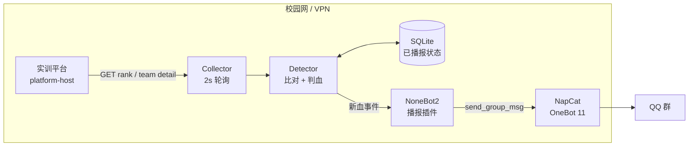

# CTF 榜单实时接入 QQ 群 · 技术方案（v0.1 评审稿）

> **落地状态（2026-10-21）**：方案已确认并实现，代码见仓库 `ctfblood/` + `plugins/ctf_blood/`；本文件保留为接口调研与设计依据。

> 目标：把「2026 年厦门大学网络空间安全新生赛」中每道题的一血 / 二血 / 三血，在 3 秒内播报到指定 QQ 群；比赛期间不影响平台，机器人重启不重复、不漏报。
>
> 结论先说：**平台存在一个匿名可读的“大屏榜单”接口**，只需要 `viewer_key`，不需要管理员账号，就能拿到全队分数、每题解题顺序、单队解题时间线。建议 QQ 侧用 **NapCat + NoneBot2**，自写一个约 300 行的薄插件；不要用 GZCTF 的现成 bot 直接改，因为它和本平台 API 不兼容。
>
> **先回答你的两个问题**：
> 1. 有没有暴露日志接口？——**有**：公开大屏榜单接口（匿名 + `viewer_key`）能读到做题情况；后台 `auditlog` 只是进出场日志，**不是** flag 提交日志。
> 2. 能不能查到做题情况？——**能**：每题 1/2/3 血、单队完整解题时间线、含血奖得分，均已实测验证。

---

## 0. TL;DR

| 项目 | 结论 |
|---|---|
| 数据源 | `/api/ct/public/jeopardy_race/race/{race_id}/rank/`（匿名 + `viewer_key`） |
| 判血依据 | `rank_detail[].checker_score[i].rank`，1 = 一血，2 = 二血，3 = 三血（已用历史赛事验证 7/7 题） |
| 精确时间 | 单队接口 `/rank/{team_id}/` 返回 `create_time`，只对触发播报的队按需拉取 |
| QQ 方案 | NapCat（OneBot 11 协议端） + NoneBot2（Python 框架） + 自写插件 |
| 架构 | 2s 轮询 → 内存比对 → SQLite 幂等 → OneBot 发群消息 |
| 实测开销 | 30 队 32.8 KB/次，55–123 ms；2s 轮询约 16 KB/s，比赛 7 小时约 400 MB |
| 主要风险 | QQ 小号风控；`viewer_key` 泄露/轮换；平台 HTTP 明文与后台默认口令 |
| 预估工期 | 3 个工作日（10/22 开发、10/23 联调演练、10/24 早上上线） |

---

## 1. 调研情况

### 1.1 平台指纹

| 项 | 实测 |
|---|---|
| 系统名称 | 厦门大学网络空间安全实训靶场 |
| 入口 | `http://<platform-host>` |
| 前端 | Vue 2 SPA，三个入口：`/page/mg`（平台管理）、`/page/oj`（练习）、`/page/ct`（比赛 + 大屏） |
| 后端 | Django / DRF（从 404 页面与错误结构判断），错误码 `MP-xxxxxx`（平台）、`AD-xxxxxx`（赛事），JWT 鉴权 |
| 鉴权头 | `Authorization: JWT <token>`（不是 Bearer） |
| 登录 | `POST /api/mp/auth/login`，密码前端 DES-ECB 加密；多次失败/触发风控后要求图形验证码 |
| 暴露的文档 | `/swagger-ui.html`、`/v2/api-docs`、`/actuator`、`/druid` 均为 404，未发现 Swagger/Actuator 泄露 |
| 传输 | 纯 HTTP，无 TLS |

> 说明：本次调研在管理员授权下进行，以只读 GET 为主；未提交 flag、未修改题目/成绩、未将选手个人信息写入仓库或对外提供（审计日志仅在临时目录用于验证，未入库）。调研中两次“态势初始化/模拟”接口的调用情况见附录 B，需要赛前复核。

### 1.2 目标赛事

从后台赛事列表实测读到 4 场比赛，目标场次为：

| 字段 | 值 |
|---|---|
| 赛事 ID | `c31c2221ce8a052461d3600ebbb32ff5` |
| 名称 | 2026 年厦门大学网络空间安全新生赛 |
| 时间 | 2026-10-24 09:30 — 16:30（Asia/Shanghai） |
| 模式 | Jeopardy（解题赛），团队赛，`type=1` |
| 题目数 | 29（Web 7、Misc 6、Pwn 6、Crypto 5、Reverse 5） |
| 参赛队 | 30 支（调研时点） |
| 计分 | `stat_mode=0`（静态分），`reward_mode=1`（一血 5% / 二血 3% / 三血 1% 加成） |
| 可见性 | `is_hide=true`（未开赛隐藏），`is_show_rank=true` |
| 状态 | `progress=0`（未开始），总分 0，尚未产生解题记录 |

`reward_mode=1` 很关键：平台本身就在按“一血/二血/三血”给动态加分，所以它一定在数据库里记录了每题的解题顺序——这正是我们可以复用的数据。

### 1.3 可用数据接口（实测）

#### 1.3.1 核心：公开大屏榜单接口（匿名）

**① 全量榜单 + 每题解题顺序**

```http
GET /api/ct/public/jeopardy_race/race/{race_id}/rank/?page=1&per_page=1000&viewer_key={viewer_key}
```

无需 Cookie、无需 JWT，只要 `viewer_key`。实测返回：

```json
{
  "code": "AD-000000",
  "data": {
    "checker_detail": [
      {
        "name": "Echo Key",
        "score": 100,
        "checkpoint_id": "cd3ed3a4d61e62fb52a4a15ebcec5c81",
        "direction": "Crypto"
      }
    ],
    "rank_detail": [
      {
        "resource_id": "567821480315574b1746d99fb5993b71",
        "score": 0,
        "solved": 0,
        "rank": 1,
        "name": "队名",
        "checker_score": [
          { "rank": 0, "is_solved": false }
        ]
      }
    ],
    "reward_mode": 1,
    "total": 30
  }
}
```

字段语义（已用历史赛事逐题核对）：

| 字段 | 含义 |
|---|---|
| `checker_detail[i]` | 第 i 道题的元数据；**数组顺序与 `checker_score` 下标一一对应** |
| `checker_detail[i].checkpoint_id` | 题目 ID，用于和单队时间线关联 |
| `rank_detail[j].resource_id` | 队伍 ID（唯一，建议作为状态主键；队名可能重复） |
| `rank_detail[j].checker_score[i].is_solved` | 该队是否解出第 i 题 |
| `rank_detail[j].checker_score[i].rank` | **该队在第 i 题上的解题顺序**：1/2/3 即一/二/三血；0 表示未解出 |
| `rank_detail[j].score` | 当前总分（含血奖） |
| `reward_mode` | 1 = 启用一/二/三血加成 |

> 注意：`rank` 的血序只有在 `reward_mode=1` 时才有意义；`reward_mode=0` 的赛事即使解出，`rank` 也可能一直是 0（历史 `新生赛test` 就是这种情况）。机器人启动时应校验 `reward_mode`，若不等于 1，则退化为“只播首杀/不播血”并告警，避免把所有解出都误判成一血。

**② 单队解题时间线**

```http
GET /api/ct/public/jeopardy_race/race/{race_id}/rank/{team_id}/?viewer_key={viewer_key}
```

```json
{
  "data": [
    {
      "creator": "member01",
      "score": 100,
      "create_time": "2026-10-19 14:18:41",
      "checkpoint": {
        "resource_id": "5641bd91652fe6143da18ab4444c2269",
        "name": "Folded Echo",
        "direction": "Reverse"
      }
    }
  ]
}
```

这是**精确解题时间**的来源。只在检测到新的一/二/三血时，按需拉取对应队伍，一次请求即可拿到该队所有题的解题记录。

**③ 赛事基础信息**

```http
GET /api/ct/public/jeopardy_race/race/{race_id}/base/?viewer_key={viewer_key}
```

返回 `race_name`、`start_time`、`end_time`、`count_down`、`is_show_rank` 等，可用于判断开赛/结束、自动停播。

#### 1.3.2 管理端接口（JWT，机器人不需要）

| 接口 | 用途 | 实测结论 |
|---|---|---|
| `GET /api/ct/admin/jeopardy_race/race/` | 赛事列表 | 可用，返回 4 场比赛 |
| `GET /api/ct/admin/jeopardy_race/race/{id}/manage/` | 赛事管理详情 | 返回 `viewer_key`，可用于初始化配置 |
| `GET /api/ct/admin/jeopardy_race/race/auditlog/?race_id={id}` | 审计日志 | **只是进场/退场（或登录/登出）记录**（`log_type` 0/1、用户、IP、时间），不是 flag 提交日志 |
| `GET /api/ct/admin/jeopardy_race/race/auditlog/export/?race_id={id}` | 审计日志导出 | 导出 `.xls`，内容同样是用户/IP/时间 |

> 结论：后台没有暴露“flag 提交/判题结果”的日志接口；`auditlog` 是赛场进出审计，不能用来判血。

#### 1.3.3 `viewer_key` 从哪来

- 后台「比赛管理 → 赛事 → 大屏」链接形如：
  `http://<platform-host>/page/ct/public/ctf/screen/{race_id}/{viewer_key}`
- 也可通过管理端 `manage/` 接口读取。
- 每场赛事一个 32 位十六进制 key，实测不随请求变化；是否随“重置比赛”轮换未验证。
- **机器人只需要这个 key，不需要管理员账号密码**，这是本方案在安全上最大的优点。

#### 1.3.4 为什么机器人不走管理端

| 原因 | 说明 |
|---|---|
| 管理端没有解题日志 | `auditlog` 只有进出场，不能判血 |
| 凭据风险 | 登录要处理 DES-ECB 加密、验证码；把管理员密码放 bot 主机不值得 |
| 公开接口数据更全 | 直接带每题血序和单队时间线，正好够用 |
| 只读、无状态 | 不需要 token 续期，不受 7 天 JWT 过期影响 |

> 管理员账号只在“初始化配置”时人工取一次 `viewer_key`，之后机器人只拿 key。

### 1.4 实测验证：`rank` 到底是不是“血”

用历史赛事「Web安全CTF随堂测试赛」（`62bfa4ba4a61d356a9c6192076f26e24`，50 队、7 题、173 条解题记录、`reward_mode=1`）做交叉验证：

1. 从榜单接口取每题 `rank=1/2/3` 的队伍；
2. 用单队时间线接口拉取全部 50 队的解题记录，按 `create_time` 排序取每题最早 3 条；
3. 两边逐题比对。

结果：

| 指标 | 结果 |
|---|---|
| 参与比对的题目 | 7 |
| 血序完全一致 | 7 / 7 |
| 应播报血事件 | 21 条（7 题 × 3 血） |
| 不一致 | 0 |

样例（已匿名化）：

| 题目 | 一血 | 二血 | 三血 |
|---|---|---|---|
| disabled_button | A 队 09:01:18 | B 队 09:02:43 | C 队 09:02:48 |
| easysql | D 队 09:11:19 | E 队 09:53:01 | F 队 10:10:57 |

同时确认：血奖分值确实体现在 `score` 上（100 分题的一/二/三血分别为 105/103/101），播报时可以直接展示“得分”。

### 1.5 接口暴露面与安全评估

| 接口 | 鉴权 | 能读到什么 | 风险 | 建议 |
|---|---|---|---|---|
| `/api/ct/public/.../rank/` | `viewer_key` | 所有队伍分数、每题解题顺序、题目名单/分值 | 中 | 把 key 当秘密；赛前不要公开大屏链接 |
| `/api/ct/public/.../rank/{team_id}/` | `viewer_key` | 单队完整解题时间线 | 中低 | 同上；可加访问频率限制 |
| `/api/ct/public/.../base/` | `viewer_key` | 赛事时间、倒计时、是否展示排名 | 低 | 无需处理 |
| `/api/ct/admin/.../auditlog/` | JWT | 进场/退场、IP | 低 | 已有权限控制 |
| `/api/mp/auth/login` | 账号密码 | 签发 7 天 JWT | **高** | 改默认口令、全站 HTTPS、限制管理端网段 |

重点发现：

1. **隐藏赛事也能被公开接口读到**：目标赛事 `is_hide=true`、未开赛，但用 `viewer_key` 已经能读到 29 道题的题名、方向和分值。若大屏链接在赛前被投屏/转发，等于提前泄题（至少泄题名和分值）。建议赛前不要打开/分享大屏链接；本次调研用过的 key 若平台支持轮换，赛前换一次，赛后也换。
2. **后台仍是初始口令（调研时点）**：登录返回 `MP-110005 密码需要变更`，但依然签发了 JWT；说明管理员账号还在用初始密码。赛前必须改。
3. **全站 HTTP**：管理员密码（DES-ECB 加密，密钥硬编码在前端）和 JWT 都在明文链路上传输；比赛现场同一局域网内可被嗅探。建议 nginx 上 TLS，或至少把管理端限制在管理 VLAN。
4. **没有 flag 提交审计**：`auditlog` 只有进出场，出事故（误判、作弊申诉）时无法回溯“谁在什么时候提交了什么”。建议平台侧补一个提交审计/导出，或至少保留单队时间线快照。

> 对机器人的直接影响：我们只用第 1 类公开接口，**不把管理员账号放到机器人主机上**；即使机器人被攻破，攻击者也拿不到后台权限。

---

## 2. 需求与验收指标

### 2.1 功能需求

| 编号 | 需求 |
|---|---|
| F1 | 每题首次被解出时，播报“一血”（题目、方向、队伍、时间、得分） |
| F2 | 第 2、3 个解出该题的队伍，分别播报“二血”“三血” |
| F3 | 同一事件只播报一次；机器人重启/断网恢复后不重复 |
| F4 | 机器人中途重启，能补报停机期间产生的血事件（带“补报”标记） |
| F5 | 比赛开始前/结束后不误报；可在赛前用测试赛事演练 |
| F6 | 支持配置群号、播报级别（只播一血 / 播前三血）、是否 @全体（默认否） |
| F7 | 提供 `/ctf status` 等管理命令，仅管理员可用 |

### 2.2 非功能需求

| 项 | 指标 |
|---|---|
| 端到端延迟 | 从平台产生解题记录到 QQ 群可见，p95 ≤ 3 s（轮询 2 s） |
| 准确率 | 血序 100% 正确；重复消息 0；漏报 0（在平台接口正常的前提下） |
| 可用性 | 比赛 7 小时内机器人可用性 ≥ 99%；单次接口失败自动重试 |
| 平台影响 | 只读 GET；30 队规模下带宽 < 20 KB/s；不登录后台、不写数据 |
| 安全 | 机器人主机不保存管理员密码；`viewer_key` 放 `.env`，不入 git |
| 可维护 | 配置化赛事 ID / key / 群号；日志可追溯每条播报 |

### 2.3 验收标准

1. 回放历史赛事数据，21 条血事件全部检出、0 重复、0 漏报；
2. 断网 2 分钟后恢复，补报事件带 `[补报]`，且不重复已发事件；
3. 机器人重启后，已发事件不重发；
4. 赛事重置/题目顺序变化时，能检测并重新基线，不产生错乱播报；
5. 真机联调：测试群收到格式正确的消息，延迟 ≤ 3 s；
6. 比赛日 09:30 开赛后，首条真实一血在 3 s 内到群。

---

## 3. 总体架构

### 3.1 架构图



纯文本版：

```
平台 <platform-host>
   │  GET /api/ct/public/.../rank  (2s)
   ▼
Collector ──► Detector ──► SQLite（幂等/补报）
                  │
                  ▼
             NoneBot2 ──► NapCat ──► QQ 群
```

### 3.2 数据流

1. **采集**：每 2 s 拉一次全量榜单（30 队约 33 KB）。
2. **判血**：遍历每题，取 `rank ∈ {1,2,3}` 且 `is_solved=true` 的（题目, 血位, 队伍）。
3. **幂等**：以 `(race_id, checkpoint_id, blood_level)` 为唯一键，查 SQLite；已发过则跳过。
4. **补时间**：对新事件，调一次单队时间线，取 `create_time` 和 `score`；失败则用检测时间并标记“约”。
5. **发送**：组装消息，经 NoneBot2 → NapCat → 群；成功后写 `sent_at`。
6. **自愈**：下一轮继续全量比对，停机期间漏掉的事件会被重新发现并补报。

> 关键设计：**不依赖“增量事件流”，而是每轮从全量榜单重算“当前应存在的血”**。这样即使漏了一轮、重启、断网，也能自愈；代价是每轮多一次全量 JSON 解析（30 队规模可忽略）。

### 3.3 技术选型

| 层 | 选型 | 理由 |
|---|---|---|
| 采集 | Python 3.11 + `httpx` | 异步、超时/重试简单；和 NoneBot 同栈 |
| 状态 | SQLite（WAL） | 单机、零运维、事务够用；比赛规模不需要 Redis |
| QQ 协议端 | **NapCat** | OneBot 11 实现，基于 NTQQ，2026 年仍活跃（最近提交 2026-10）；Docker 部署成熟 |
| QQ 框架 | **NoneBot2** | Python 异步、OneBot v11 适配器、插件/命令/定时任务齐全；社区大 |
| 部署 | Docker Compose | NapCat + bot 两个容器，数据卷持久化 |

### 3.4 为什么不用现成的 CTF bot

| 项目 | 能否直接用 | 说明 |
|---|---|---|
| [GZCTF-BOT-QQ](https://github.com/MoRan23/GZCTF-BOT-QQ) | ❌ 不能直接 | 它对接的是 GZCTF 的 `/api/game/...`，与本平台 API 不兼容；但它的 **3 血播报、Docker Compose、NapCat 反连** 做法可以直接借鉴 |
| CTFd 系 QQ 插件 | ❌ | 只适配 CTFd |
| go-cqhttp | ❌ | 已停止维护，不建议新项目使用 |
| 官方 QQ 机器人 | ⚠️ 受限 | 合规，但群内主动推送需要权限/白名单，不适合“任意群 + 主动播报” |

所以推荐：**成熟协议端（NapCat）+ 成熟框架（NoneBot2）+ 薄适配插件**。真正要写的只有“拉榜单 → 判血 → 发消息”这一层，约 300 行。

> 如果希望尽量少写代码，也可以 fork GZCTF-BOT-QQ，保留它的 NoneBot 插件骨架、消息模板、Docker Compose，只把 GZCTF 客户端替换成本文的公开榜单客户端。但它的判血/状态层仍要重写，且它默认把管理员账号密码放进容器（GZ_USER/GZ_PASS），本方案不建议沿用这一点。

---

## 4. 数据接入设计

### 4.1 接口契约

#### 4.1.1 榜单

```http
GET {BASE}/api/ct/public/jeopardy_race/race/{race_id}/rank/?page=1&per_page=1000&viewer_key={vk}
```

| 参数 | 说明 |
|---|---|
| `page` | 从 1 开始；30 队时一页足够 |
| `per_page` | 实测 1000 可一次返回全部；上限未探测 |
| `viewer_key` | 赛事大屏 key，32 位 hex |

返回 `code=AD-000000` 为成功；`data.total` 是队伍数。

#### 4.1.2 单队时间线

```http
GET {BASE}/api/ct/public/jeopardy_race/race/{race_id}/rank/{team_id}/?viewer_key={vk}
```

返回数组，元素：

| 字段 | 说明 |
|---|---|
| `checkpoint.resource_id` | 题目 ID，和 `checkpoint_id` 对应 |
| `checkpoint.name` / `direction` | 题名 / 方向 |
| `score` | 该次解题得分（含血奖） |
| `create_time` | 解题时间（平台本地时间，Asia/Shanghai） |
| `creator` | 解题人（团队赛时是成员名，不是队名） |

> 注意：团队赛里 `creator` 是成员，不是队伍名；播报队伍名要用榜单里的 `rank_detail[].name`，不要用 `creator`。

#### 4.1.3 基础信息

```http
GET {BASE}/api/ct/public/jeopardy_race/race/{race_id}/base/?viewer_key={vk}
```

用于读 `race_name`、`start_time`、`end_time`、`count_down`、`is_show_rank`。

**启动自检**（任一不满足则告警并停止播报，避免误报）：

- `reward_mode == 1`（否则没有血序）；
- `is_show_rank == true`；
- `checker_detail` 非空；
- 每支队的 `len(checker_score) == len(checker_detail)`；
- `viewer_key` 能正常返回 `code=AD-000000`。

### 4.2 判血算法

```python
# 伪代码：每轮执行
snap = fetch_rank(race_id, viewer_key)          # 一次 HTTP
assert len(snap.checker_detail) == len(snap.rank_detail[0].checker_score)

# 题目顺序变化保护：用 checkpoint_id 序列做指纹
fp = sha1([c.checkpoint_id for c in snap.checker_detail])
if state.fingerprint and fp != state.fingerprint:
    state.rebaseline(snap)                       # 跳过本轮，避免错位播报
    return
state.fingerprint = fp

for i, ch in enumerate(snap.checker_detail):
    for team in snap.rank_detail:
        cs = team.checker_score[i]
        if not cs.is_solved or cs.rank not in (1, 2, 3):
            continue
        key = (race_id, ch.checkpoint_id, cs.rank)
        if store.already_announced(key):
            continue
        detail = fetch_team_detail(team.resource_id)   # 按需，一次
        solve = find(detail, ch.checkpoint_id)
        emit(BloodEvent(
            race_id=race_id, challenge_id=ch.checkpoint_id,
            challenge_name=ch.name, direction=ch.direction,
            blood=cs.rank, team_id=team.resource_id, team_name=team.name,
            solve_time=solve.create_time if solve else now(),
            score=solve.score if solve else ch.score,
            time_exact=bool(solve),
        ))
```

关键点：

- **下标只用于“本轮取值”**：协议规定 `checker_score[i]` 与 `checker_detail[i]` 按下标对齐，取值时必须用下标；
- **身份/状态键必须用 ID**：题目用 `checkpoint_id`、队伍用 `team_id`，不要用题名（可能重名）或队名（可能重名/改名）；
- `rank` 只在 1/2/3 时播报；4 名以后不播。
- 同一题同一血位只有一个队，唯一键天然幂等。
- 题目顺序指纹变化时，本轮只重建基线、不播报，下一轮恢复。
- **血序回填不自动改判**：若管理员删队/判作弊导致某题血序变化，机器人以“首次观测”为准（唯一键已占），不会把已发的三血改成另一队；赛后以平台最终榜单为准，必要时人工补发更正。

### 4.3 精确时间与分值

- 时间：优先用单队时间线的 `create_time`；拉取失败则用本地检测时间，消息里标 `约`。
- 分值：优先用单队时间线的 `score`（含血奖，如 105）；失败则用题目的基础分。
- 时区：平台返回的是 Asia/Shanghai 本地时间，机器人主机要设同一时区，并开 NTP。

### 4.4 轮询与幂等

| 项 | 设计 |
|---|---|
| 轮询间隔 | 默认 2 s；可配 1–5 s |
| 超时 | 连接 2 s / 读 3 s |
| 重试 | 单轮失败重试 2 次（指数退避 0.5 s、1 s）；连续 5 轮失败告警 |
| 单飞 | 上一轮未结束时跳过本轮，避免堆请求 |
| 分页 | 按 `data.total` 循环拉取；30 队一页够用，超过 `per_page` 时自动翻页 |
| 幂等 | SQLite `UNIQUE(race_id, challenge_id, blood_level)`；`INSERT OR IGNORE` |
| 发送状态 | `pending → sent`；发送失败保留 pending，下轮重试，最多 5 次 |
| 补报 | 启动时若发现“应存在但未播”的血，按 `[补报]` 发送 |
| 重置检测 | 若总分/已解数**连续两轮显著下降**（如总分归零、已解数下降 >50%），判定赛事被重置：清空该 race 的播报状态，发一条“数据已重置”公告，重新基线；单队退赛/被封不应触发 |

> “发送成功”以 NapCat 返回 `retcode=0` 为准；QQ 侧实际投递失败（被撤回/风控）无法完全感知，只能靠日志和群内反馈。

### 4.5 性能估算

| 规模 | 单次 payload | 2 s 轮询带宽 | 7 小时总量 |
|---|---|---|---|
| 30 队 × 29 题 | 32.8 KB | ~16 KB/s | ~400 MB |
| 100 队 × 30 题 | ~100 KB | ~50 KB/s | ~1.2 GB |
| 200 队 × 30 题 | ~200 KB | ~100 KB/s | ~2.5 GB |

局域网完全可接受。若队伍数很大，可把间隔放宽到 3–5 s，或只拉 `per_page` 分页的前若干页（但会漏队，不推荐）。

---

## 5. QQ 播报设计

### 5.1 协议端与框架

**推荐组合：NapCat + NoneBot2**

- NapCat：基于 NTQQ 的 OneBot 11 实现，Docker 镜像 `mlikiowa/napcat-docker`，WebUI 扫码登录，支持正向/反向 WS。
- NoneBot2：Python 异步框架，`nonebot-adapter-onebot` 连 NapCat，插件里用 `bot.send_group_msg(...)`。
- 连接方式：Compose 内 bot 主动连 `ws://napcat:3001`（NapCat `MODE=ws`），或 NapCat 反连 `ws://bot:8080/onebot/v11/ws`。

**备选：**

| 方案 | 评价 |
|---|---|
| NapCat + Koishi | 也成熟，TypeScript 生态；团队若更熟 JS 可选 |
| LuckyLilliaBot（原 LLOneBot） + NoneBot2 | 可用，支持 OneBot 11/Satori/Milky；作为 NapCat 的备选协议端 |
| Lagrange.OneBot | V1 已归档、V2 不再支持 OneBot 11，不建议新项目 |
| 官方 QQ 机器人 | 合规优先，但群主动推送限制多，不适合本场景 |

### 5.2 消息模板

单条（默认）：

```text
🏆 一血
Web · easysql
队伍：做的都不队
时间：10:42:13
得分：105
```

```text
🩸 二血
Crypto · raseaC
队伍：xxx
时间：10:43:01
得分：103
```

三血同理，图标用 `🩸`，标题写“三血”。

全场首杀（可选，默认开）：

```text
⚡ 全场首杀！
10:31:02 · Web/easysql
队伍：xxx（一血）
```

补报：

```text
🩸 二血（补报）
Web · easysql
队伍：xxx
解题时间：10:43:01
```

合并播报（同一 2 s 窗口内 ≥3 条时）：

```text
【10:42:13 血报】
🏆 一血 Web/easysql — A队（105）
🩸 二血 Web/easysql — B队（103）
🩸 三血 Web/easysql — C队（101）
```

格式原则：

- 纯文本，不用 Markdown（QQ 不渲染）；
- 队名可能含 emoji/特殊字符，原样展示；
- 不 @全体，避免打扰和风控；
- 单条不超过 200 字。

### 5.3 发送策略与限流

| 场景 | 策略 |
|---|---|
| 正常 | 每条事件立即发，间隔 ≥ 1 s |
| 洪峰（开局简单题） | 2 s 窗口内合并为一条“血报”，最多 6 行；超出分两条 |
| 重试 | 失败指数退避 1/2/4 s，最多 5 次；仍失败则记 `failed` 并私聊管理员 |
| 频率 | 令牌桶 1 msg/s，burst 3；绝不 @全体 |
| 静默 | 比赛结束（`end_time` 后）自动停播；可配“只播一血”降噪 |

### 5.4 内容安全

- **CQ 码注入**：队名是用户可控内容。发消息时必须用 **消息段数组**（`MessageSegment.text(...)`），不要拼字符串，防止队名里的 `[CQ:at,qq=all]` 被执行。
- **敏感词**：队名可能含脏话/政治敏感词，建议加一个可配置的替换表；至少不要让群被封。
- **长度**：截断超长队名（>40 字符）。
- **日志**：只记录队名/题名/时间/血位，不记录 token、key、管理员密码。

### 5.5 群与权限

- 机器人账号拉进目标群，给“允许发言”；不需要管理员。
- 管理命令（`/ctf status`、`/ctf test`、`/ctf reload`）只对 `SUPERUSERS` 生效，建议私聊使用。
- 群号、赛事 ID、`viewer_key` 全部走环境变量/`.env`，不写死代码。

---

## 6. 部署方案

### 6.1 网络拓扑

```text
[校园网 / VPN]
  <platform-host> 平台  ◄── HTTP ──  bot 主机（Linux, Docker）
                                      │
                                      └── 出站 443 ──► 腾讯 QQ 服务器（NapCat 登录/发消息）
```

要求：

1. bot 主机能访问 `<platform-host>:80`；
2. bot 主机能出站访问腾讯（NapCat 登录、发消息）；
3. NapCat 的 6099 WebUI 只绑 `127.0.0.1` 或管理网段，不要暴露公网；
4. 若 bot 主机在云端、平台在校园内网：加 WireGuard/SSH 隧道，只放行平台 80 端口。

### 6.2 主机规格

| 项 | 建议 |
|---|---|
| CPU/内存 | 2 vCPU / 2 GB 足够（NapCat 占内存，bot 很轻） |
| 磁盘 | 10 GB |
| 系统 | Ubuntu 22.04 / Debian 12 |
| 时间 | NTP 开启，时区 Asia/Shanghai |
| 网络 | 与平台同一校园网/VPN，延迟 < 50 ms |

### 6.3 Docker Compose（草案）

```yaml
services:
  napcat:
    image: mlikiowa/napcat-docker:latest
    restart: unless-stopped
    environment:
      MODE: ws
      WEBUI_TOKEN: ${NAPCAT_TOKEN}
    ports:
      - "127.0.0.1:6099:6099"   # WebUI 只给本机/跳板机
    volumes:
      - ./data/qq:/app/.config/QQ
      - ./data/napcat:/app/napcat/config

  bot:
    build: .
    restart: unless-stopped
    depends_on:
      - napcat
    env_file: .env
    volumes:
      - ./data/bot:/app/data
```

`.env`（示例，**不要提交真实 key**）：

```dotenv
CTF_BASE_URL=http://<platform-host>
CTF_RACE_ID=c31c2221ce8a052461d3600ebbb32ff5
CTF_VIEWER_KEY=<从后台大屏链接复制>
CTF_GROUP_ID=<群号>
CTF_POLL_INTERVAL=2.0
CTF_BLOOD_LEVELS=1,2,3
CTF_CATCHUP_MODE=announce
CTF_DRY_RUN=false
ONEBOT_ACCESS_TOKEN=<随机串>
NAPCAT_TOKEN=<另一个随机串>
```

### 6.4 上线步骤

1. 装 Docker / Compose；
2. `docker compose up -d napcat`，打开 `http://127.0.0.1:6099/webui`，扫码登录机器人 QQ；
3. 配置 NapCat 正向 WS（3001），确认 `get_login_info` 正常；
4. `docker compose up -d bot`，看日志确认连上 OneBot；
5. 用测试群跑 `DRY_RUN=true`，确认能打印血事件；
6. 切 `DRY_RUN=false`，发一条测试消息；
7. 比赛日 08:30 前启动，09:30 自动开播。

### 6.5 比赛日 Runbook

| 时间 | 动作 |
|---|---|
| T-1d | 回放测试通过；确认 `viewer_key` 未变；测试群收到测试消息 |
| T-1h | 启动容器；确认 NapCat 在线；`/ctf status` 正常；确认榜单基线（0 血） |
| T-0 | 开赛；观察首条一血是否 ≤3 s；检查日志无 401/403 |
| T+30m | 抽查 3 条播报与后台榜单一致 |
| T+7h | 停播；导出当日播报记录；保存日志 |
| T+1d | 轮换 `viewer_key`；复盘 |

---

## 7. 测试方案

### 7.1 回放测试（不需要碰真比赛）

用历史赛事 `62bfa...` 的真实解题记录做 fixture：

- 50 队、7 题、173 条解题、21 条血事件；
- 按时间轴重放，喂给 Detector；
- 断言：21 条事件、血序正确、无重复、无漏报。

这是最关键的回归测试，能在不接触线上赛事的情况下验证判血逻辑。

### 7.2 单元测试

| 用例 | 断言 |
|---|---|
| 正常三血 | 3 条事件，血位 1/2/3 |
| 同题第 4 解 | 不播 |
| 重复轮询 | 不重复播 |
| 题目顺序变化 | 本轮不播，重建基线 |
| 赛事重置（已解数下降） | 清状态 + 公告 + 重新基线 |
| 单队时间线失败 | 用检测时间，标“约” |
| 队名含 CQ 码 | 原样文本，不触发 at |
| 发送失败 | 保留 pending，下轮重试 |

### 7.3 联调

- 用一个**测试赛事**（可复制目标赛事，或使用现有 `新生赛test`）做端到端；
- 测试账号提交 flag（需要 organizer 准备测试 flag），观察 2–3 s 内群消息；
- 不碰 10/24 的正赛数据。若必须用正赛演练，务必在赛前重置/清空。

### 7.4 验收清单

- [ ] 回放 21/21，0 重复
- [ ] 真机延迟 p95 ≤ 3 s
- [ ] 重启不重发
- [ ] 断网恢复能补报
- [ ] 消息格式/队名特殊字符正常
- [ ] 管理命令权限正确
- [ ] 平台侧无异常登录/无写入

---

## 8. 风险与对策

| 风险 | 概率 | 影响 | 对策 |
|---|---|---|---|
| QQ 小号被风控/冻结 | 中 | 高 | 专用小号、固定 IP、低频发送、不 @全体；备用号；赛前 3 天养号 |
| `viewer_key` 失效/轮换 | 中 | 高 | 启动时校验；失败告警；提供 `/ctf reload` 或改 `.env` 重启 |
| 平台接口变更/字段改名 | 低 | 高 | 契约测试 + 启动自检；保留原始 JSON 日志 |
| 公开接口被平台关闭 | 低 | 高 | 备选：管理员把 bot 账号加入比赛，走 `/web/jeopardy_race/race/{id}/rank/`（需账号/参赛）；或让平台方加只读 token |
| 网络中断 | 中 | 中 | 本地 SQLite 缓存；恢复后补报 |
| 赛事重置/改题 | 低 | 中 | 检测分数回退/题目指纹变化，清状态并公告 |
| 消息洪峰 | 中 | 低 | 合并 + 令牌桶 |
| 队伍重名 | 中 | 低 | 全程用 `team_id` |
| 主机时钟漂移 | 低 | 低 | NTP；消息时间以平台 `create_time` 为准 |
| 管理员误操作（如赛前点“模拟数据”） | 低 | 中 | 机器人只读；赛前检查大屏状态；操作双人复核 |

---

## 9. 工期与分工

| 日期 | 工作 | 产出 |
|---|---|---|
| 10/21（今天） | 方案评审、接口确认、环境准备 | 本方案定稿；bot 主机/QQ 小号就绪 |
| 10/22 | Collector + Detector + SQLite + 单测 | 可回放 21/21 的核心逻辑 |
| 10/23 | NoneBot 插件 + Compose + 联调 | 测试群端到端；演练通过 |
| 10/24 08:30 | 上线、基线检查 | 09:30 自动开播 |
| 10/24 赛后 | 停播、导出记录、复盘 | 播报日志、问题清单 |

人力：1 名后端/脚本开发 + 1 名平台管理员（提供 key、测试赛事、群权限）。

---

## 10. 待确认问题

1. **群号/多群**：只播一个群，还是多个群？群是否允许机器人发言？
2. **播报范围**：每题一/二/三血都播，还是只播一血？要不要“全场首杀”？
3. **消息内容**：是否带分值、解题时间、当前排名？是否需要 @ 相关队伍（建议不 @）？
4. **机器人账号**：是否已有专用 QQ 小号？是否接受“非官方协议端”的风控风险？
5. **部署位置**：bot 跑在校园网哪台机器？能否出站访问腾讯？是否需要 VPN？
6. **演练**：能否提供一个测试赛事/测试账号，用于端到端提交 flag？正赛数据是否允许赛前重置？
7. **赛后**：是否需要自动生成“最终榜单/一血榜”汇总发群？

---

## 附录 A：实测样本（已脱敏）

### A.1 榜单（截取）

```json
{
  "code": "AD-000000",
  "data": {
    "checker_detail": [
      {"name": "Echo Key", "score": 100, "checkpoint_id": "cd3e...", "direction": "Crypto"},
      {"name": "mixmix", "score": 500, "checkpoint_id": "d95f...", "direction": "Crypto"}
    ],
    "rank_detail": [
      {
        "resource_id": "5678...",
        "score": 0,
        "solved": 0,
        "rank": 1,
        "name": "示例队",
        "checker_score": [
          {"rank": 0, "is_solved": false},
          {"rank": 0, "is_solved": false}
        ]
      }
    ],
    "reward_mode": 1,
    "total": 30
  }
}
```

### A.2 单队时间线（截取）

```json
{
  "data": [
    {
      "creator": "member01",
      "score": 105,
      "create_time": "2026-05-27 09:01:18",
      "checkpoint": {"resource_id": "5b0d...", "name": "easysql", "direction": "Web"}
    }
  ]
}
```

### A.3 响应时间

| 场景 | 时间 | 大小 |
|---|---|---|
| 30 队榜单 | 55–123 ms | 32.8 KB |
| 50 队榜单 | 54–121 ms | 21.2 KB |
| 单队时间线 | 40–106 ms | 1–2 KB |

---

## 附录 B：调研操作记录与需要复核的事项

**只读操作（主要）：**

- `GET /`、`/page/mg/*`、`/page/ct/*` 前端资源；
- `GET /api/mp/sys/config/public`、`/api/mp/sys/activation/license_status`；
- `GET /api/ct/admin/jeopardy_race/race/`、`.../{id}/manage/`、`.../auditlog/`、`.../auditlog/export/`（JWT）；
- `GET /api/ct/public/jeopardy_race/race/{id}/rank/`、`.../rank/{team_id}/`、`.../base/`（匿名 + viewer_key）。

**需要复核的两次调用：**

在确认“态势/大屏”接口语义时，对目标隐藏赛事发起过：

- `GET /api/ct/admin/jeopardy_race/race/{id}/init_situation/` → 返回“初始化成功”
- `GET /api/ct/admin/jeopardy_race/race/{id}/simulate_situation/` → 返回“开始模拟数据”

这两个动作在后台 UI 上对应“初始化态势/模拟数据”，虽然方法是 GET，但**语义上可能改变大屏态势状态**。事后核对：

- 赛事 `progress=0`、`is_hide=true`、30 队、总分 0、题目数 29，均未变化；
- 公开榜单仍为 0 分、0 解题；
- 未发现模拟数据写入榜单。

**建议**：10/23 演练时，由平台管理员在后台打开该赛事的大屏/态势页，确认没有残留模拟数据；如有，按平台流程做一次赛前重置（注意“重置比赛”会清空成绩/报名，需确认后再操作）。

---

## 附录 C：参考资料

- NapCat（OneBot 11 协议端）：https://github.com/NapNeko/NapCatQQ
- NapCat 快速开始：https://mintlify.wiki/NapNeko/NapCatQQ/quickstart
- NapCat Docker：https://github.com/NapNeko/NapCat-Docker
- NoneBot2：https://github.com/nonebot/nonebot2
- GZCTF-BOT-QQ（3 血播报参考实现）：https://github.com/MoRan23/GZCTF-BOT-QQ
- LuckyLilliaBot（原 LLOneBot）：https://github.com/LLOneBot/LuckyLilliaBot
- Lagrange 关于 OneBot 11 的说明：https://lagrangedev.github.io/Lagrange.Doc/v2/

---

*文档版本：v0.1（2026-10-21）· 作者：自动化调研 · 仅供赛事组委会内部评审*
